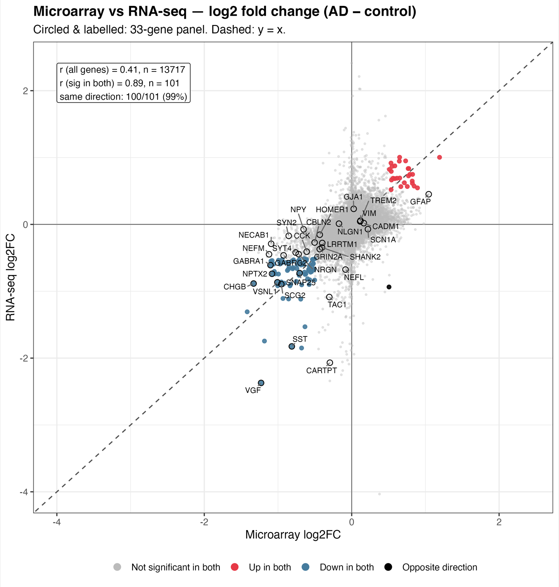
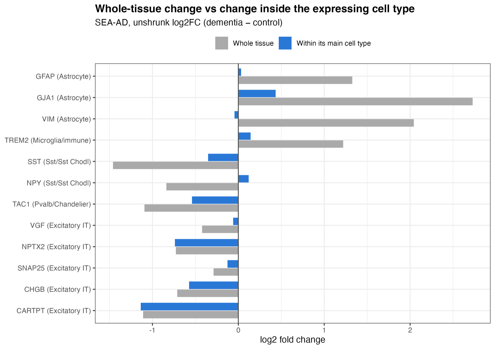
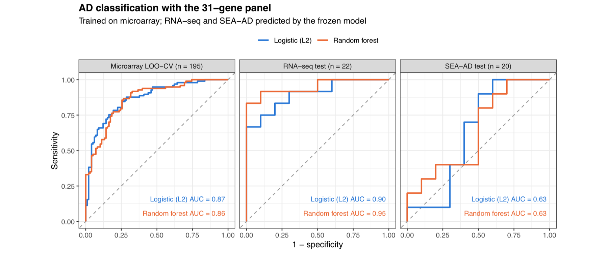
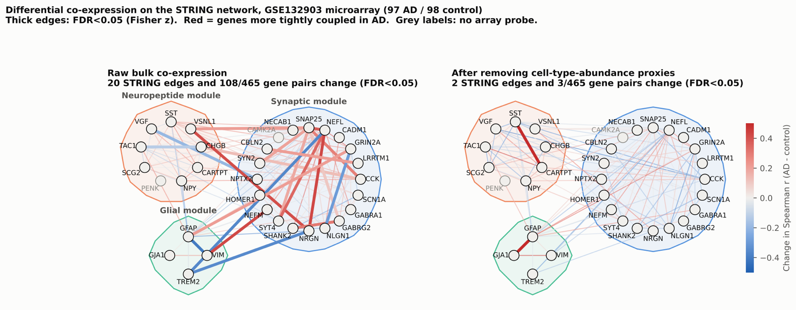

# A reproducible Alzheimer’s disease transcriptomic signature across three platforms


**Suraj Rathi, BTech Life Sciences** · [Full report (PDF, 25 pages)](report/AD_Transcriptomics_Report_Suraj_Rathi.pdf)

Do Alzheimer’s disease (AD) gene-expression changes in human brain replicate across measurement technologies? And are they changes *inside* cells, or changes in *which* cells are present? This project analyses three temporal-cortex datasets (microarray, bulk RNA-seq and single-nucleus RNA-seq) with platform-appropriate models, validates every result against explicit null models, resolves the single-nucleus data by cell type, trains a cross-platform classifier, and studies the core genes as a network.

## Key findings

| | Result |
|---|---|
| **Reproducible across platforms** | Among genes significant in two datasets, 93–100% change in the same direction (100/101 microarray–RNA-seq; 73/73 microarray–SEA-AD). Genome-wide r = 0.26–0.41 vs a gene-shuffle null of ±0.02. |
| **Neuronal loss, glial gain** | VGF, SST, NPTX2 and SNAP25 decrease; GFAP, GJA1 and VIM increase in AD. |
| **Largely cell composition** | Glial genes rise in tissue (median log2FC +1.68) but barely change per cell (+0.09). Somatostatin interneurons halve and astrocytes expand ~2.8× in dementia. |
| **Transferable classifier** | Trained on microarray (LOO-CV AUC 0.87) and applied unchanged to independent RNA-seq: AUC 0.90–0.95, 11/12 AD brains detected. |
| **Network rewiring is compositional** | Co-expression changes among panel genes: 108/465 pairs → 3/465 after removing cell-abundance effects. |
| **Candidate regulator** | REST, a repressor of neuronal genes, is the top TRRUST regulator of the down-regulated genes (FDR 2 × 10⁻⁵). |

<p align="center">


</p>
<p align="center">

</p>
<p align="center">

</p>

## Data

| Dataset | Technology | Region | AD / control | Model | Significant genes* |
|---|---|---|---|---|---|
| [GSE132903](https://www.ncbi.nlm.nih.gov/geo/query/acc.cgi?acc=GSE132903) | Illumina HT-12 v4 microarray | Middle temporal gyrus | 97 / 98 | limma | 724 |
| [GSE104704](https://www.ncbi.nlm.nih.gov/geo/query/acc.cgi?acc=GSE104704) | Bulk RNA-seq | Lateral temporal lobe | 12 / 10 | DESeq2 + apeglm | 857 |
| [SEA-AD](https://portal.brain-map.org/explore/seattle-alzheimers-disease) | snRNA-seq, donor pseudobulk | Middle temporal gyrus | 10 / 10 | DESeq2 + apeglm | 1,436 |

\*padj < 0.05 and |log2FC| > 0.5; positive log2FC = higher in AD.

## Repository structure

```
├── analysis/                     differential expression, comparison, validation, cell types, ML
│   ├── dataset1_microarray/      01_limma_analysis.R, 01b_figures.R
│   ├── dataset2_rnaseq/          02_deseq2_analysis.R, 02b_figures.R
│   ├── dataset3_seaad/           03_pseudobulk_deseq2.R, 03b_figures.R,
│   │                             03c_build_celltype_pseudobulk.R, 03d_celltype_deseq2.R
│   ├── comparison/               04_comparison.R
│   ├── validation/               05a–05d validation scripts, VALIDATION_REPORT.md
│   └── ml_classification/        06_ml_classification.R, RESULTS_INTERPRETATION.md
├── network/                      STRING, differential co-expression, WGCNA, TRRUST
│   ├── scripts/                  p2_00 (R) … p2_07 (Python; p2_04 WGCNA in R)
│   ├── data/                     STRING v12.5 + TRRUST v2 files
│   └── README_RESULTS.md
├── report/                       full report (PDF + HTML) and its figures
├── data/                         raw inputs (not in Git) — see data/README.md
├── tests/reproduce_check.sh     reruns the GEO-only steps and compares with committed results
├── install_packages.R, requirements-R.txt, requirements.txt
└── .ad_project_root              marker used by scripts to find the repository root
```

Each folder has `scripts/`, `results/` (CSV tables and run logs with `session_info()`) and `figures/`.

## Reproduce

```bash
git clone https://github.com/ratbro2211/Alzheimers-Transcriptomic-Signature.git
cd Alzheimers-Transcriptomic-Signature
Rscript install_packages.R && pip install -r requirements.txt
bash data/download_data.sh                 # GEO (~48 MB) + SEA-AD (~8 GB, AWS CLI)
```

Run in this order (scripts find the repository root themselves; or set `AD_PROJECT_ROOT`):

| Step | Command | Runtime* |
|---|---|---|
| Microarray DE | `Rscript analysis/dataset1_microarray/scripts/01_limma_analysis.R` (+ `01b_figures.R`) | ~1 min |
| RNA-seq DE | `Rscript analysis/dataset2_rnaseq/scripts/02_deseq2_analysis.R` (+ `02b_figures.R`) | ~1 min |
| SEA-AD pseudobulk DE | `Rscript analysis/dataset3_seaad/scripts/03_pseudobulk_deseq2.R` (+ `03b_figures.R`) | ~5 min |
| Cell-type pseudobulk | `Rscript analysis/dataset3_seaad/scripts/03c_build_celltype_pseudobulk.R` then `03d_celltype_deseq2.R` | ~45 min |
| Comparison | `Rscript analysis/comparison/scripts/04_comparison.R` | ~1 min |
| Validation | `Rscript analysis/validation/scripts/05a…05c` then `05d_validate_comparison.R` | ~40 min |
| Classifier | `Rscript analysis/ml_classification/scripts/06_ml_classification.R` | ~4 min |
| Network | `cd network && Rscript scripts/p2_00_prepare_expression.R && python scripts/p2_01_string_network.py && python scripts/p2_02_differential_network.py && python scripts/p2_03_tf_enrichment.py && Rscript scripts/p2_04_wgcna.R && python scripts/p2_05_module_coherence.py && python scripts/p2_06_celltype_resolution.py && python scripts/p2_07_figures.py` | ~10 min |

\*On an 8-core laptop. Random seeds are fixed (42). All steps write only inside their own folder.

**Reproducibility check:** after downloading the GEO data, `bash tests/reproduce_check.sh` reruns every step that does not need SEA-AD (microarray and RNA-seq DE, comparison, their validation, STRING network) and confirms the result tables are identical to the committed ones (~10 min).

## Methods in brief

- **Contrasts:** control is always the explicit reference level (AD − control), and every script stops if the coefficient name is wrong.
- **Microarray probes:** one probe per gene is kept, the one with the highest mean intensity (a choice independent of the AD/control comparison).
- **GSE104704 counts:** raw integer counts are recovered exactly from GEO’s size-factor-normalised table (max deviation 2 × 10⁻⁹).
- **SEA-AD pseudobulk:** built from raw UMIs (`layers["UMIs"]`), never from log-normalised `.X`.
- **Validation:**
  - Each dataset: label-permutation nulls, covariate adjustment, p-value calibration, PCA outliers, split-half and leave-one-out tests.
  - Comparison: hypergeometric, binomial and gene-shuffle nulls, bootstrap CIs, and a panel-circularity check.
- **Classifier:** within-dataset z-scoring (label-free). The threshold is fixed on microarray LOO-CV before either test set is touched.
- **Network:** STRING v12.5 hubs, modularity vs degree-preserving nulls, differential co-expression with cell-abundance adjustment, WGCNA and TRRUST enrichment.

## Limitations

- **The 33-gene panel is partly circular:** it was chosen for consistency across these same datasets. Within-microarray CV and the RNA-seq test are therefore optimistic, and a fourth cohort is needed for a clean test.
- **SEA-AD gene lists are exploratory:** with 10 vs 10 donors, the whole-tissue gene list does not beat its permutation null, and per-cell-type lists depend on two donors. SEA-AD groups are clinical; 5 of 10 controls have intermediate or high AD pathology.
- **Region differs:** the RNA-seq dataset sampled the lateral temporal lobe, the other two the middle temporal gyrus.
- **Post-mortem tissue only:** the classifier separates AD from control *brain tissue*; it is not a diagnostic test.

See [`analysis/validation/VALIDATION_REPORT.md`](analysis/validation/VALIDATION_REPORT.md) for every check and its verdict.

## Citation

If you use this work, please cite the repository and the original data:
Piras et al., *J Alzheimers Dis* 2019 (GSE132903); Nativio et al., *Nat Neurosci* 2018 (GSE104704); Gabitto et al., *Nat Neurosci* 2024 (SEA-AD).

## License

MIT — see [LICENSE](LICENSE).
